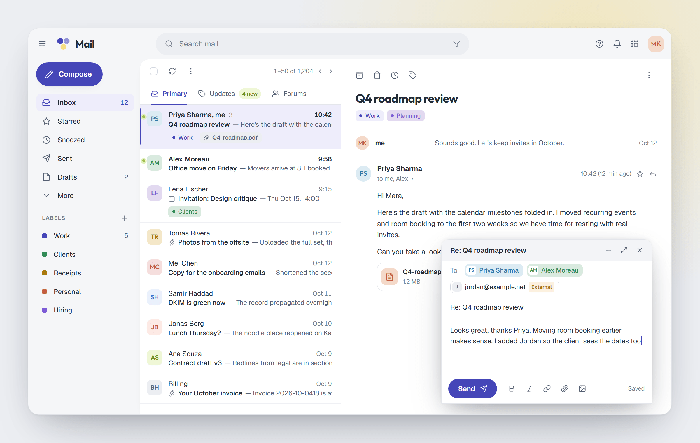
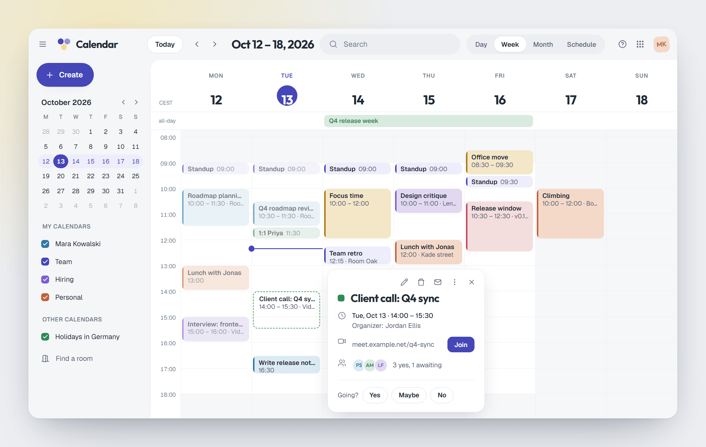
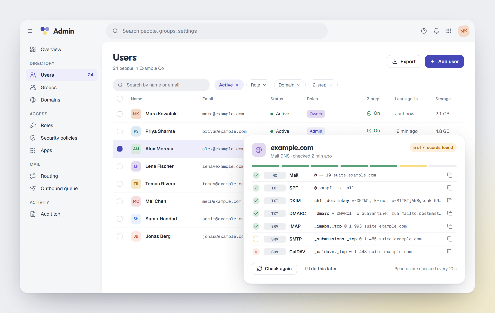
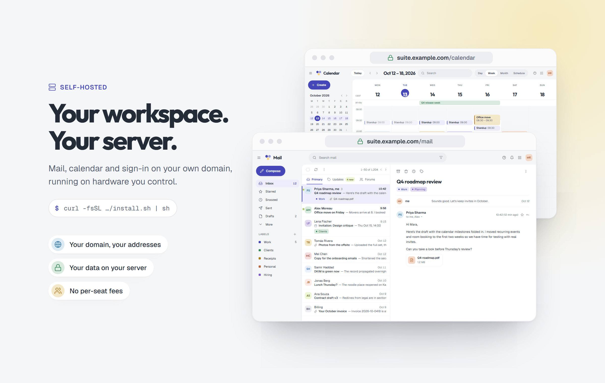
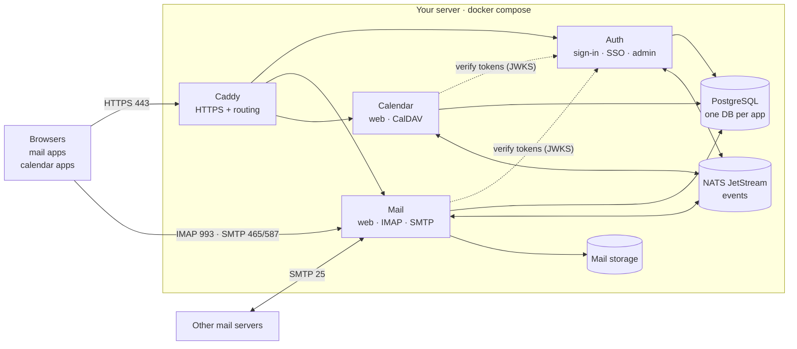
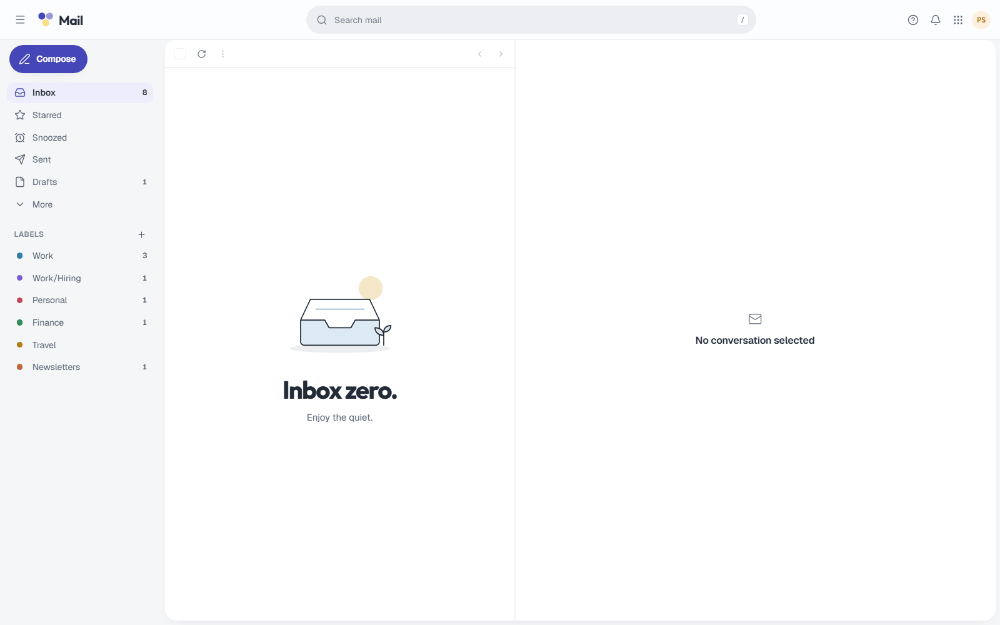
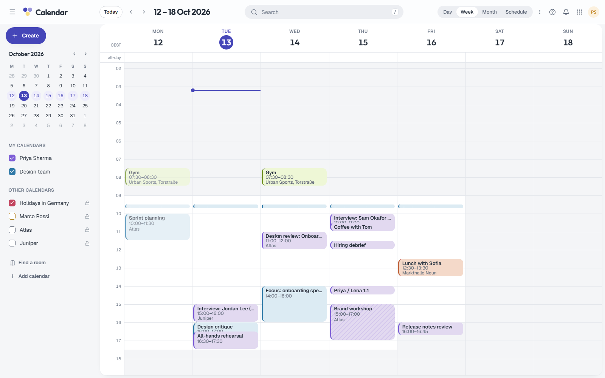

<p align="center">
  
</p>

<p align="center">
  <b>Suitehive is an open-source, self-hostable alternative to Google Workspace.</b><br>
  Mail, Calendar and single sign-on for your team, on your own domain and your own server.
</p>

<p align="center">
  <a href="#status"></a>
  <a href="#license"></a>
  
  
</p>

<p align="center">
  <a href="#quick-start">Quick start</a> ·
  <a href="#what-gets-installed">Architecture</a> ·
  <a href="#cli-reference">CLI</a> ·
  <a href="#roadmap">Roadmap</a> ·
  <a href="#repositories">Repositories</a> ·
  <a href="#contributing">Contributing</a>
</p>

---

> [!IMPORTANT]
> **Suitehive is in early development.** The first container images haven't been published yet, so
> `suitehive install` can't pull a working stack today. Until the first release you can use
> `--dry-run` to see exactly what would be installed, or `--build` to build the images from source.
> See [Status](#status).

## Why Suitehive

- **Own your data.** Mail, calendars and accounts live in your database and on your disk, not in someone else's cloud.
- **One install.** A single command sets up a gateway with automatic HTTPS, PostgreSQL, NATS and the apps on one VM.
- **Standards first.** Use the web apps, or any client you already have: IMAP and SMTP for mail, CalDAV for calendars, OpenID Connect for sign-in.
- **Private by default.** No ads and no profiling of your mail. Remote images in email are blocked until you allow them.
- **No per-seat fees.** Add your whole team. The only cost is the server you run it on.
- **Built to grow.** Each app is its own service with its own database, so Contacts, Drive and Docs can be added without touching the rest.

## Features

This is what v1 is being built to do. The images are design mockups of the planned interface;
see [Status](#status) for what runs today.

### Mail



- Fast, keyboard-friendly inbox (Gmail-style shortcuts: `j`/`k`, `e`, `r`, `c`, `/`) with conversation threading.
- Labels with pastel colors, nested labels, filters with a "preview matches" step, snooze and stars.
- Compose in docked windows with autosaved drafts, undo send, and recipient chips that flag external addresses.
- Search with operators (`from:`, `has:attachment`, `before:` …).
- Inbound checks for SPF, DKIM and DMARC; outbound DKIM signing; direct delivery or a smarthost relay.
- IMAP and SMTP submission for desktop and phone mail apps, with per-app passwords.

### Calendar



- Day, week, month and schedule views, with drag to move and resize.
- Recurring events with a plain-language editor ("Every 2 weeks on Tuesday"), time zones done right (including DST days).
- Invitations and RSVPs over standard iCalendar email, so they work with people on Gmail, Outlook and Apple Calendar.
- Free/busy, find-a-time and room booking.
- Sharing per calendar (free/busy only, see details, edit, manage) and CalDAV sync for phones and desktop apps.

### Admin and single sign-on



- One account for every app: sign in once, with passkeys or an authenticator app for 2-step verification.
- Users, groups, roles and domains in one admin console, with an audit log of every change.
- A guided DNS setup that shows each record to create (MX, SPF, DKIM, DMARC, autodiscovery) and checks it live.
- Suitehive is an OpenID Connect provider, so your other self-hosted tools can use "Sign in with Suitehive".
- Security policies: required 2-step, password rules, session length, app passwords on or off.

### Self-hosting



- One command installs everything with Docker Compose and gets HTTPS certificates automatically.
- Runs on a single VM. Our target is around 50 users on 4 vCPU and 8 GB RAM.
- Built-in `backup`, `restore` and `upgrade` commands.
- Each app can scale on its own when you outgrow one machine.

## Quick start

> [!NOTE]
> These commands are what the first release will run. Today, add `--dry-run` (writes the config and prints
> the Docker commands without running them) or `--build` (builds the images from source).

### On a server (Linux)

You need a server with a public IP, a domain you control, and ports 25, 80, 443, 465, 587 and 993 reachable.

```sh
curl -fsSL https://raw.githubusercontent.com/Suitehive/suitehive/main/install.sh | sh
```

The installer asks for your domain and admin details. To run it without prompts:

```sh
curl -fsSL https://raw.githubusercontent.com/Suitehive/suitehive/main/install.sh | sh -s -- \
  --domain example.com \
  --admin-email admin@example.com \
  --admin-name "Ada Admin" \
  --org-name "Example Co" \
  --yes
```

When it finishes, it prints your URLs (`https://suite.example.com/mail`, `/calendar`, `/admin`), the admin
login, and the DNS records to create.

### Try it on your laptop (macOS or Linux)

No domain or TLS needed. Suitehive runs at `http://localhost:8080` with demo users.

```sh
curl -fsSL https://raw.githubusercontent.com/Suitehive/suitehive/main/install.sh | sh -s -- --local
```

Sign in as `admin@suitehive.local` (or `priya@` / `alex@`) with the password `suitehive-dev`.

### Try it on Windows

With [Docker Desktop](https://www.docker.com/products/docker-desktop/) running, in PowerShell:

```powershell
irm https://raw.githubusercontent.com/Suitehive/suitehive/main/install.ps1 | iex
```

To pass options, download the script first: `& ([scriptblock]::Create((irm https://raw.githubusercontent.com/Suitehive/suitehive/main/install.ps1))) -DryRun`.

### From a clone

```sh
git clone https://github.com/Suitehive/suitehive.git
cd suitehive
./bin/suitehive install --local --dry-run
```

## What gets installed



| Service | Image | What it does |
|---|---|---|
| `caddy` | `caddy:2.10` | Public entry point. Gets TLS certificates from Let's Encrypt and routes `/login`, `/account`, `/admin`, `/api/auth` → Auth, `/mail` → Mail, `/calendar` and `/dav` → Calendar. |
| `auth` | `ghcr.io/suitehive/auth` | Organizations, users, groups, domains, sessions, 2-step, OpenID Connect provider, admin console, audit log. |
| `mail` | `ghcr.io/suitehive/mail` | Mail web app and API, SMTP (25, 465, 587), IMAP (993), spam and authentication checks, delivery queue. |
| `calendar` | `ghcr.io/suitehive/calendar` | Calendar web app and API, CalDAV, invitations, reminders, free/busy. |
| `postgres` | `postgres:17` | One cluster with a separate database per app (`suitehive_auth`, `suitehive_mail`, `suitehive_calendar`). |
| `nats` | `nats:2.11-alpine` | JetStream event bus. Apps talk through events (for example "user created → create mailbox") instead of sharing tables. |

Everything lives in one directory (`/opt/suitehive` by default): `.env` with your settings and generated
secrets (readable only by its owner), `docker-compose.yml`, `Caddyfile`, and `backups/`.

## Requirements

| | Server install | Local trial |
|---|---|---|
| OS | Linux (x86_64 or arm64) | macOS, Linux, or Windows with Docker Desktop |
| Docker | Docker Engine with Compose v2 | Docker Desktop or Engine with Compose v2 |
| Memory | 4 GB minimum, 8 GB recommended | 4 GB free |
| Disk | 20 GB + your mail | 5 GB |
| Network | Public IP; inbound 25, 80, 443, 465, 587, 993; outbound 25 | Port 8080 free |
| DNS | A domain you can add records to | None |

Many cloud providers block outbound port 25 by default. Ask them to open it, or configure a smarthost
relay for outgoing mail. Set the server's reverse DNS (PTR) to your Suitehive hostname.

## DNS setup

The installer and `suitehive dns` print the exact records for your domain. For `example.com` with Suitehive at
`suite.example.com` (server IP `203.0.113.10`) they look like this:

| Type | Name | Value | Purpose |
|---|---|---|---|
| A | `suite.example.com` | `203.0.113.10` | The Suitehive host (add AAAA too if you have IPv6) |
| TXT | `example.com` | *shown by the installer* | Proves you own the domain |
| MX | `example.com` | `10 suite.example.com.` | Receive mail |
| TXT | `example.com` | `v=spf1 mx -all` | SPF: only your server sends for this domain |
| TXT | `_dmarc.example.com` | `v=DMARC1; p=quarantine; rua=mailto:postmaster@example.com` | DMARC policy |
| TXT | `sh1._domainkey.example.com` | *generated after the domain verifies* | DKIM signing key |
| SRV | `_imaps._tcp.example.com` | `0 1 993 suite.example.com.` | Mail app autodiscovery (IMAP) |
| SRV | `_submissions._tcp.example.com` | `0 1 465 suite.example.com.` | Mail app autodiscovery (SMTP) |
| SRV | `_caldavs._tcp.example.com` | `0 1 443 suite.example.com.` | Calendar app autodiscovery |

`suitehive dns` checks every record and marks it found, missing or different. The admin console shows the
same checklist under **Admin → Domains**, including the DKIM record once it's generated.

## CLI reference

The installer puts the `suitehive` command in `/usr/local/bin` (or `~/.local/bin` without root). Every
command takes `--help`, and `--dir`, `--yes` work everywhere.

| Command | What it does |
|---|---|
| `suitehive install` | Checks the machine, generates secrets, writes `.env`, `docker-compose.yml` and `Caddyfile`, starts the stack, creates your organization and admin, and prints URLs and DNS records. Flags: `--domain`, `--hostname`, `--admin-email`, `--admin-name`, `--admin-password`, `--org-name`, `--dir`, `--tls-email`, `--version`, `--local`, `--build`, `--yes`, `--dry-run`, `--force` (new secrets, fresh start only), `--skip-checks` (allow less than 4 GB RAM). |
| `suitehive status` | Shows each service, its health, the installed version and your URLs. |
| `suitehive logs [service] [-f] [--tail n]` | Shows the last 200 log lines for all services or one (`caddy`, `postgres`, `nats`, `auth`, `mail`, `calendar`). |
| `suitehive upgrade [--version X] [--backup]` | Offers a backup, refreshes the templates, pulls new images and restarts. Your `.env` and data are kept. |
| `suitehive backup [--out file]` | Writes a `.tar.gz` with a database dump, your mail storage and your config. The archive contains secrets, so keep it safe. |
| `suitehive restore <file> [--keep-env]` | Replaces all current data with a backup (asks you to type the domain first). Also works on a fresh server. |
| `suitehive dns [--check \| --no-check] [--token T]` | Prints the DNS records to create and checks which ones already exist. With an admin API token it also prints the DKIM record. |
| `suitehive uninstall [--purge]` | Stops and removes the containers. Your data is kept unless you add `--purge` (asks you to type the domain). |
| `suitehive version` | Prints the CLI version, the installed Suitehive version and the Docker Compose version. |

Most `install` flags also work as environment variables (`SH_DOMAIN`, `SH_HOSTNAME`, `SH_ADMIN_EMAIL`,
`SH_ADMIN_PASSWORD`, `SH_VERSION`, `SH_DIR` …), which is handy for automation.

## Roadmap

**v1 (in progress)**
- [ ] **Auth and Admin:** organizations, domains, users, groups, roles, passkeys and 2-step, OpenID Connect, audit log, first-run setup
- [ ] **Mail:** web app, SMTP in and out, IMAP, threads, labels, search, filters, DKIM/SPF/DMARC
- [ ] **Calendar:** web app, recurrence, invitations, free/busy, rooms, reminders, CalDAV
- [ ] One-command install, backups and upgrades
- [ ] First published container images

**Next**
- Contacts (CardDAV)
- Drive (files and sharing)
- Docs, Sheets and Slides with real-time collaboration
- Chat
- Import from Google Workspace

## Status

Suitehive is in **early development**. The design is written and the services and web apps are being
built in the open. Today:

- Container images under `ghcr.io/suitehive/*` **are not published yet.** `suitehive install` will fail to
  pull them until the first release. Use `--dry-run` to inspect the generated setup, or `--build` to clone
  the source repositories and build the images locally.
- Expect breaking changes to configuration, APIs and data until v1.
- Don't use it for production mail yet.

Early preview of the current web apps (development build with demo data):

<p>
  
  
</p>

## Repositories

Suitehive is split into small repositories that each own one part of the system.

| Repository | What's inside |
|---|---|
| [**suitehive**](https://github.com/Suitehive/suitehive) | This repo: the installer, the `suitehive` CLI and the deployment templates |
| [architecture](https://github.com/Suitehive/architecture) | Design documents: high-level design, service designs, UI design system |
| [kit](https://github.com/Suitehive/kit) | Shared Go library: config, database, outbox, events, auth middleware, telemetry |
| [contracts](https://github.com/Suitehive/contracts) | Protobuf RPC and event schemas, OpenAPI specs, generated Go and TypeScript clients |
| [ui](https://github.com/Suitehive/ui) | Design tokens, React components and the shared app shell |
| [auth](https://github.com/Suitehive/auth) | Auth service with the sign-in, account and admin web apps |
| [mail](https://github.com/Suitehive/mail) | Mail service (SMTP, IMAP, API) and the Mail web app |
| [calendar](https://github.com/Suitehive/calendar) | Calendar service (API, CalDAV) and the Calendar web app |
| [deploy](https://github.com/Suitehive/deploy) | Development compose setup, Helm chart and gateway configuration |

Services are written in Go, and the web apps in React and TypeScript. Services only depend on `kit` and
`contracts`, never on each other's code.

## Contributing

Suitehive is early, which makes this a good time to shape it.

- **Try it and tell us what breaks.** Run `./bin/suitehive install --local --dry-run` and open an issue with anything confusing.
- **Read the design first.** The [architecture](https://github.com/Suitehive/architecture) repo explains how the pieces fit together and why.
- **Pick a repo.** Each one has its own README with build and test instructions. Issues labelled `good first issue` are a good start.
- **Discuss bigger changes first.** Open an issue before a large pull request so we can agree on the approach.

For this repository: keep `install.sh` POSIX `sh`, keep `bin/suitehive` passing `bash -n`, and run
`./bin/suitehive install --local --dry-run --yes --dir /tmp/sh-test` before sending a change.

Please report security problems privately to the maintainers instead of opening a public issue.

## License

The license has not been chosen yet. Until it is, no license is granted to use, copy or distribute this code.
A license will be added before the first release.

<p align="center">
  <br>
  
</p>
